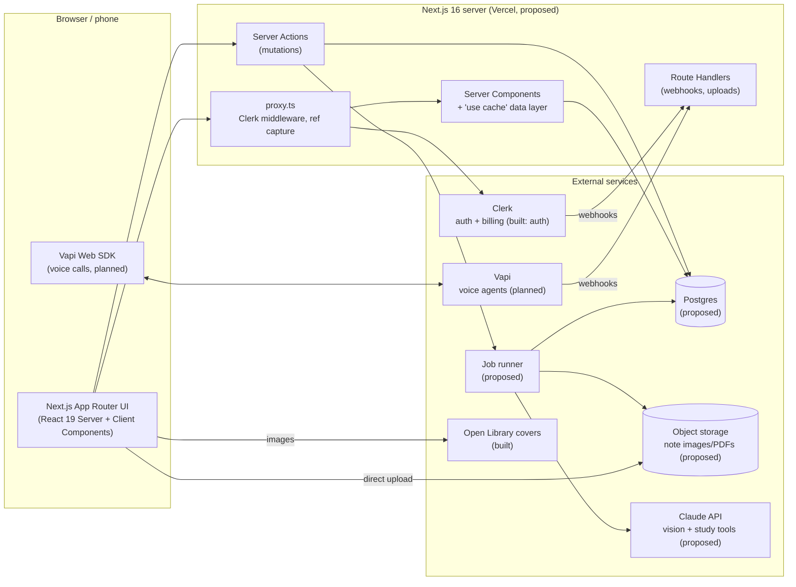
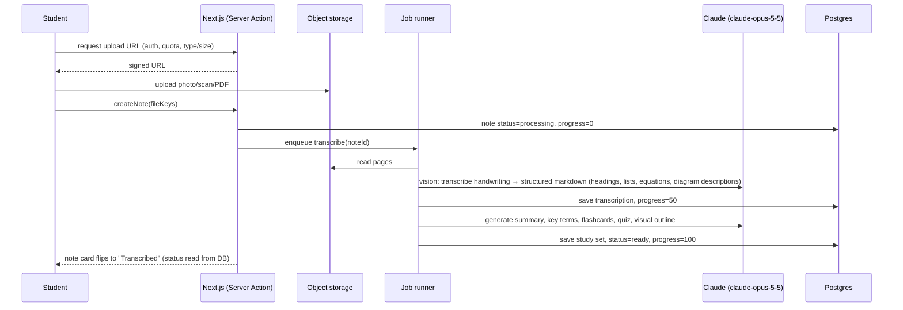

# Architecture

HandNotesAI turns handwritten notes (photos, scans, PDFs) into a visual, student-friendly study space: clean transcriptions, summaries, flashcards and quizzes, with notes read aloud and a voice tutor powered by Vapi. A book library comes second. This document describes the full system: what exists today, the target architecture, how data, rendering, auth, AI, voice and billing fit together, and the engineering decisions behind them.

Status labels used throughout:
- **Built**: in the repo now.
- **Planned**: agreed direction, not implemented yet.
- **Proposed**: recommendation awaiting a decision (see [Open decisions](#13-open-decisions)).

Related docs: [UI_ENGINEERING.md](UI_ENGINEERING.md) (the 20 interaction patterns in detail) · [DESIGN.md](DESIGN.md) · [TYPESCRIPT.md](TYPESCRIPT.md) · [SECURITY.md](SECURITY.md).

---

## 1. Principles

1. **Server-first.** Data is read in Server Components and changed through Server Actions. The client holds only UI state, never a second copy of the database.
2. **Instant shell, streamed data.** Cache Components prerenders the App Shell; user data streams behind `<Suspense>` with skeletons.
3. **Auth at the data layer.** Every read and write checks the Clerk session and ownership where the data is accessed, not just in `proxy.ts`.
4. **Typed end to end.** Shared types in `types/`, schemas at every boundary, `ActionResult` for expected errors ([TYPESCRIPT.md](TYPESCRIPT.md)).
5. **Forgiving UX.** Optimistic updates, autosave, undo, offline-tolerant actions, and errors that never lose work ([UI_ENGINEERING.md](UI_ENGINEERING.md)).
6. **Feature-modular.** Code is grouped by domain (`features/notes`, `features/voice`…), so a feature can be understood, changed or removed in one place.

---

## 2. System overview



---

## 3. Tech stack

| Layer | Choice | Status |
| --- | --- | --- |
| Framework | Next.js **16.4** App Router, Turbopack, `cacheComponents`, `partialPrefetching` | Built |
| UI runtime | React **19.3** (`useOptimistic`, `useActionState`, `<Activity>`) | Built |
| Language | TypeScript (strict + `noUncheckedIndexedAccess`) | Built |
| Styling | Tailwind CSS v4, design tokens in `app/globals.css`, warm literary theme | Built |
| Components | shadcn/ui (`base-nova` style on `@base-ui/react`), `lucide-react` icons, `tw-animate-css` | Built |
| Fonts | IBM Plex Serif (headings) + Mona Sans (UI) via `next/font` | Built |
| Auth | Clerk (`@clerk/nextjs` v7, `@clerk/ui` shadcn theme), `proxy.ts` | Built |
| Billing / tiers | Clerk Billing (`<PricingTable />`, `has({ feature })`) | Planned |
| Database | Postgres + Drizzle ORM (type-safe schema → TS types) | Proposed |
| File storage | S3-compatible object storage with signed URLs (e.g. Cloudflare R2, AWS S3 or Vercel Blob) | Proposed |
| Background jobs | Durable job runner for transcription pipelines (e.g. Inngest or Trigger.dev) | Proposed |
| AI | Claude API via `@anthropic-ai/sdk`: `claude-opus-5-5` for handwriting transcription (vision) and study-tool generation | Proposed |
| Voice | Vapi (`@vapi-ai/web` client SDK + server-side assistant config + webhooks) | Planned |
| Client state | Zustand (+ `nuqs` for URL state). See [§10](#10-state-management) | Proposed |
| Forms / validation | Zod schemas shared client/server; React Hook Form for complex forms | Proposed |
| Tables / palette / toasts | TanStack Table, `cmdk` (shadcn Command), `sonner` | Proposed |
| Security review | Claude Code Security Review GitHub Action on every PR | Built |
| Error tracking / analytics | e.g. Sentry; e.g. PostHog | Proposed |
| Testing | Vitest (units) + Playwright (E2E, with `@clerk/testing`) | Proposed |
| Hosting | Vercel | Proposed |

---

## 4. Repository structure

**Today (built):**

```
app/                     routes: layout.tsx, page.tsx (home), sign-in/, sign-up/, globals.css, favicon.ico
components/              Navbar, NavMenu, HeroSection, NoteCard, BookCard, SectionHeader, ui/button
lib/                     constants.ts (content + dummy data), utils.ts
types/                   shared types (book, note, navigation, components) + index barrel
public/                  brand assets (logos, hero, note thumbnails, patterns, OG image)
scripts/                 build-assets.mjs (asset generator)
docs/                    this documentation
.github/                 security review workflow + scan instructions
proxy.ts                 Clerk middleware
```

**Target (planned):** feature modules plus route groups. Move existing files when their feature is built, not all at once.

```
app/
├── (marketing)/              public, statically rendered, top Navbar
│   ├── page.tsx              landing
│   ├── pricing/              Clerk <PricingTable />
│   └── affiliates/           public affiliate program page
├── (auth)/sign-in, sign-up   Clerk pages
├── (app)/                    signed-in app shell: persistent sidebar (#4)
│   ├── layout.tsx            AppSidebar + MobileTabBar + CommandPalette
│   ├── library/              notes + books overview (today's home content)
│   ├── notes/                list · new · [slug] (viewer/editor, study tools, listen)
│   ├── books/                list · [slug] (reader + voice chat)
│   ├── study/                flashcard review, quizzes
│   ├── voice/                voice session history
│   ├── referrals/            referral dashboard
│   ├── affiliates/dashboard/ approved affiliates
│   ├── onboarding/           first-run capture (#15)
│   └── settings/             profile, preferences, billing portal
├── api/webhooks/{clerk,vapi,billing}/route.ts
├── not-found.tsx · error.tsx · global-error.tsx
features/
├── notes/        components/ · notes-queries.ts · notes-actions.ts · notes-schema.ts · notes-filters.ts
├── books/        …same shape
├── study/        flashcards, quizzes, spaced repetition
├── voice/        Vapi client wrapper, voice store, assistant config builder (server)
├── ai/           transcription + generation pipeline steps, prompts
├── billing/      TierGate, UsageMeter, PlanBadge, quota checks
├── referrals/    referral + affiliate logic
└── onboarding/
components/       shared, domain-free UI: ui/ (shadcn), layout/, feedback/, data-table/, command-palette/
hooks/            useDebouncedCallback, useThrottledCallback, useAutosave, useHotkeys, useConfirm…
stores/           Zustand stores (client-only UI state)
lib/              db client, ai client, storage client, auth helpers (requireUserId), constants, utils
types/            shared types (see TYPESCRIPT.md)
```

**Rules.**
- `features/*` may import from `components`, `hooks`, `lib`, `types` and `stores`, but **never from another feature's internals**. Cross-feature use goes through a feature's public exports.
- Server-only modules (`*-queries.ts`, `lib/db`, `lib/ai`) start with `import 'server-only'`.

---

## 5. Routes

| Route | Purpose | Rendering | Status |
| --- | --- | --- | --- |
| `/` | Home: hero, Your Notes, Book Library | Static shell + streamed data | Built (dummy data) |
| `/sign-in`, `/sign-up` | Clerk auth | Catch-all, `<Suspense>` | Built |
| `/onboarding` | First-run data capture (#15) | Dynamic, signed in | Planned |
| `/notes`, `/notes/new`, `/notes/[slug]` | Notes list, capture/upload, note study view | Shell + streamed user data | Planned |
| `/books`, `/books/[slug]` | Library, reader + voice | Shell + streamed data | Planned |
| `/study` | Flashcard review, quizzes | Dynamic | Planned |
| `/voice` | Voice session history | Dynamic | Planned |
| `/subscriptions` (or `/pricing`) | Plans via `<PricingTable />` | Static | Planned |
| `/referrals`, `/affiliates`, `/affiliates/dashboard` | Referral and affiliate program (#16) | Mixed | Planned |
| `/settings` | Profile, preferences, billing | Dynamic | Planned |
| `/api/webhooks/*` | Clerk, billing, Vapi events | Route Handlers, signature-verified | Planned |

---

## 6. Rendering, caching and data flow

**Rendering model (Cache Components).**
- Each route has a prerendered **App Shell**: layout, navigation, headings and skeletons. `<Link>` prefetches that shell (Partial Prefetching), so navigations are instant.
- User-specific data reads the session at request time, so it always sits behind `<Suspense>` and streams in.
- Up to 3 recently visited routes stay mounted but hidden (React `<Activity>`), preserving drafts, scroll position and audio state across navigation.

**Reads.**

```
Server Component (inside <Suspense>)
  → userId = await requireUserId()             // lib/auth.ts: Clerk auth(), throws/redirects if signed out
  → getNotes(userId, filters)                  // features/notes/notes-queries.ts ('server-only')
       'use cache'; cacheTag(`notes:${userId}`); cacheLife(...)
       → db query WHERE user_id = userId       // ownership in the query itself
       → returns DTOs typed from types/        // never raw DB rows to the client
```

The session is read *outside* the cached function and the `userId` is passed *in*, so it becomes part of the cache key. Cached data can never be shared between users. This follows Next's *Authentication with Cache Components* guide.

**Writes.**

```
Client (form / button, often with useOptimistic)
  → Server Action (features/<domain>/<domain>-actions.ts, 'use server')
      1. userId = await requireUserId()
      2. input = schema.safeParse(formData)     → { ok:false, error:{ code:'VALIDATION', fieldErrors } }
      3. quota / tier check (has({ feature }))  → { ok:false, error:{ code:'LIMIT_REACHED' } }
      4. db write scoped to userId (transaction where needed)
      5. updateTag(`notes:${userId}`)           // read-your-own-writes
      6. return { ok:true, data }
```

- Use `updateTag` in Server Actions (immediate expiry for the writer).
- Use `revalidateTag` in Route Handlers and webhooks.
- Use `refresh()` when only the router needs re-rendering.

**Uploads.**
- The client asks a Server Action for a short-lived signed upload URL (it checks auth, quota, type and size).
- The file uploads straight to object storage, never through the Next server.
- Then the client calls `createNote`, which records the note as `processing` and enqueues the pipeline (§8).

---

## 7. Authentication and authorization

- **Clerk** owns identity and sessions (built). `ClerkProvider` sits inside `<body>` with the shadcn theme; `signInUrl`/`signUpUrl` point to the app's own pages.
- **`proxy.ts`** (built) runs `clerkMiddleware()`. Planned additions:
  - Protect `(app)` routes.
  - Redirect users without the `onboardingComplete` session claim to `/onboarding`.
  - Capture `?ref=` into a first-party cookie (#16).
- **Authorization happens where data is touched:** `requireUserId()` at the top of every query and action, plus `user_id` conditions in every SQL statement. A record that exists but isn't yours is a 404 (never reveal existence).
- **Tier gates:** `has({ feature })` / `auth.protect({ feature })` on the server. `<Show when={{ feature }}>` only for display (#14).
- **Webhooks:** Clerk via `verifyWebhook`; billing and Vapi via their signature or secret headers. All are idempotent (event id stored).
- **Secrets:** server-only env vars; only the Clerk publishable key and the Vapi *public* key are `NEXT_PUBLIC_*`. See [SECURITY.md](SECURITY.md).

---

## 8. AI pipeline: handwriting → visual study material



- **Steps are idempotent and resumable.** Each step stores its output, so a retry resumes from the failed step and partial results are kept (#20).
- **Progress** maps to `ProcessingNote.progress` (`types/note.ts`). The UI polls or streams status (§10). Jobs survive reloads and navigation.
- **Visual study outputs:**
  - The clean transcription shown side by side with the original page image.
  - Highlighted key terms, a summary, and a mind map or outline.
  - Flashcards with spaced-repetition scheduling, and quizzes.
- **Prompting and safety:** note text is untrusted input. Prompts treat it as data, outputs are rendered as sanitized Markdown, and tool use is limited (see [SECURITY.md](SECURITY.md)).
- **Cost control:** per-tier quotas checked before enqueueing; images resized and deduplicated; generation results cached per note version.
- **Model choice:** `claude-opus-5-5` by default for transcription and generation. Per-task model choices are an open decision (§13).

---

## 9. Voice: reading aloud and voice tutoring (Vapi)

- **Use cases:**
  - "Listen to this note": read the transcription aloud.
  - "Quiz me by voice": a spoken flashcard drill.
  - "Discuss this book or note" with a voice tutor.
- **Client:** a `features/voice` wrapper around the Vapi Web SDK, created lazily on first use (not in the initial bundle). It starts a call with an assistant configured for the current note or book.
- **Server:**
  - Builds the assistant configuration and context (note excerpt, study goals) in a Server Action, after the auth and `voice_minutes` quota checks.
  - The private Vapi key never reaches the client.
  - Vapi webhooks (call ended, transcript, usage) go to `/api/webhooks/vapi`, which verifies the secret and records minutes used and the session transcript.
- **Client state:** call status (idle → connecting → listening ↔ speaking → ended / error), live transcript, mute and volume level live in a dedicated voice store (§10). The UI components are the existing `vapi-*` classes in `globals.css`.
- **Resilience:** dropped calls offer Reconnect and keep the transcript; calls never auto-restart (#20). Volume and level updates are throttled to animation frames (#8).

---

## 10. State management

State is split by **where the truth lives**. Most state does *not* need a client library.

| Kind of state | Examples | Owner |
| --- | --- | --- |
| Server data | notes, books, study sets, usage, plan | Server Components + `'use cache'` (tagged per user); changed by Server Actions + `updateTag` |
| Optimistic overlays | pin, rename, flashcard rating, bulk move | React `useOptimistic` (#1) |
| URL state | filters, search, sort, page, active tab, open panel | Search params, typed with **`nuqs`** (proposed) (#11, #12) |
| Form state | onboarding, uploads, settings | `useActionState` or React Hook Form + Zod (#9) |
| Local component state | dropdown open, hover, input value | `useState` / `useReducer`, preserved across navigation by `<Activity>` |
| **Shared client UI state** | sidebar collapsed, command palette open, bulk selection, upload queue, toasts | **Zustand** stores (proposed) |
| **Realtime / session state** | Vapi call status, live transcript, volume level, audio player position | **Zustand** voice/audio stores (proposed), updated from SDK event handlers |
| Persisted preferences | sidebar width, recent commands, audio speed | Zustand `persist` (localStorage) + cookie where SSR needs it |
| Polled job status | transcription progress | Server-rendered status + lightweight polling of a status endpoint; add TanStack Query only if client polling grows (open decision) |

**Recommended tool: Zustand** (with `nuqs` for URL state). Why it fits this architecture:
- **It complements Server Components instead of competing with them.** Server data stays on the server (RSC + `use cache`). Zustand only holds what the server can't: UI and realtime session state. A full client cache (Redux Toolkit Query, Apollo) would duplicate the server and fight `updateTag`.
- **It works outside React.** Vapi SDK events, audio elements and upload progress callbacks can call `useVoiceStore.getState().setStatus(...)` without hooks or providers, so the event-driven voice features stay simple.
- **Selectors prevent re-render storms.** The volume meter subscribes to `volume`, and the transcript list to `transcript`. 60 updates a second don't re-render the page. With React Context they would.
- **Small and typed:** about 1 KB, no boilerplate, a typed store interface per feature (`stores/voice-store.ts` with `interface VoiceState`), plus `persist` and `devtools` middleware.

**Usage rules:**
- One store per concern (`ui-store`, `voice-store`, `audio-store`, `upload-store`, `selection-store`), never one global store.
- Stores are client-only and never hold another user's data. If a store needs server-provided initial data, create it per request inside a provider (`createStore` + context), not as a module singleton.
- Don't copy server data into stores. Pass it as props from Server Components; let `updateTag` refresh it.

**Alternatives considered:**
- **Jotai:** a good fine-grained alternative, but less natural for SDK-driven event stores.
- **Redux Toolkit:** more ceremony than this app needs, and its cache duplicates RSC.
- **React Context only:** re-render cost with realtime voice data.
- **XState:** worth adopting *inside* the voice feature if the call lifecycle grows complex (reconnects, multi-step drills), alongside Zustand rather than replacing it.

---

## 11. UI engineering decisions

The 20 interaction patterns are product requirements. Each row links to its full specification in [UI_ENGINEERING.md](UI_ENGINEERING.md).

| # | Pattern | Decision (summary) |
| --- | --- | --- |
| 1 | [Optimistic UI updates](UI_ENGINEERING.md#1-optimistic-ui-updates) | `useOptimistic` + `useTransition` + Server Action + `updateTag`; only for reversible, likely-to-succeed actions |
| 2 | [Skeleton loaders](UI_ENGINEERING.md#2-skeleton-loaders) | Inline `<Suspense>` close to data; every data component has a same-size `*Skeleton`; zero layout shift |
| 3 | [Command palette](UI_ENGINEERING.md#3-command-palette) | ⌘K shadcn Command (`cmdk`), lazy-loaded; typed command registry; debounced server search; gated commands shown locked |
| 4 | [Persistent sidebar navigation](UI_ENGINEERING.md#4-persistent-sidebar-navigation) | `(app)` layout sidebar that never re-mounts; collapse state persisted (store + cookie); drawer + tab bar on mobile |
| 5 | [Loading and empty states](UI_ENGINEERING.md#5-loading-and-empty-states) | Six designed states per data surface; `useLinkStatus` for nav pending; step progress for AI jobs; `EmptyState` with a CTA |
| 6 | [Autosave](UI_ENGINEERING.md#6-autosave) | `useAutosave`: 800ms debounce + blur/⌘S/hide flush; versioned saves with conflict UI; `useOffline` keeps saves pending |
| 7 | [Debouncing](UI_ENGINEERING.md#7-debouncing) | Typed `useDebouncedCallback`/`useDebouncedValue`; standard delays (search 200–300ms, autosave 800ms, async validation 400ms) |
| 8 | [Throttling](UI_ENGINEERING.md#8-throttling) | `useThrottledCallback` / rAF throttle for voice levels, scroll and progress saves; server rate limits are the real control |
| 9 | [Smart form validation](UI_ENGINEERING.md#9-smart-form-validation) | Shared Zod schema client + server; blur-then-change timing; field errors via `ActionResult`; focus first error |
| 10 | [Bulk action list](UI_ENGINEERING.md#10-bulk-action-list) | Set-based selection with shift-range and "select all matching"; sticky toolbar; per-item results with partial-failure reporting |
| 11 | [Reusable data table](UI_ENGINEERING.md#11-reusable-data-table) | Generic `DataTable<TData>` on TanStack Table; server pagination; state in URL; cards on mobile; built-in states |
| 12 | [Advanced data filtering](UI_ENGINEERING.md#12-advanced-data-filtering) | Filters in URL (`nuqs`), applied server-side in the query; chips + Clear all; saved views for Pro |
| 13 | [Keyboard shortcuts](UI_ENGINEERING.md#13-keyboard-shortcuts) | Single typed shortcut map; scoped `useHotkeys`; ignore single keys in inputs; `?` help dialog |
| 14 | [Tier-based UI indicators](UI_ENGINEERING.md#14-tier-based-ui-indicators) | Clerk Billing features enforced on the server; plan badge, usage meters, visible-but-locked actions |
| 15 | [Onboarding data capture](UI_ENGINEERING.md#15-onboarding-data-capture) | 5-step autosaved flow; `onboardingComplete` session claim redirect in `proxy.ts`; answers personalize defaults |
| 16 | [Referral and affiliate pages](UI_ENGINEERING.md#16-referral-and-affiliate-pages) | `?ref=` cookie attribution; rewards granted from the billing webhook after the refund window; fraud controls |
| 17 | [Custom 404 page](UI_ENGINEERING.md#17-custom-404-page) | Global + segment `not-found.tsx`; `notFound()` for missing *or not-owned* records; search + ⌘K + links |
| 18 | [Mobile-optimized SaaS layout](UI_ENGINEERING.md#18-mobile-optimized-saas-layout) | Bottom tab bar with central Capture (camera); sheets for filters and dialogs; `dvh` + safe areas; 44px targets |
| 19 | [Destructive action protection](UI_ENGINEERING.md#19-destructive-action-protection) | Three levels: Undo (soft delete + Trash), Confirm dialog, type-to-confirm + re-auth; enforced on the server |
| 20 | [Graceful error recovery](UI_ENGINEERING.md#20-graceful-error-recovery) | `ActionResult` for expected errors; `error.tsx` with `retry()`; widget-level boundaries; offline-tolerant actions; resumable jobs |

---

## 12. Cross-cutting concerns

- **Security:** see [SECURITY.md](SECURITY.md). Every PR runs the Claude security review with project-specific rules (auth on data access, no per-user data in shared caches, upload validation, prompt injection).
- **Performance:**
  - Static shells + streaming.
  - Lazy-load heavy client code (command palette, Vapi SDK, charts, data-table virtualization).
  - `next/image` with explicit `sizes`.
  - Budgets: LCP < 2.5s, CLS < 0.1, INP < 200ms on mid-range mobile.
- **Accessibility:** WCAG 2.2 AA. Keyboard paths for everything (#13), visible focus, live regions for async results, reduced-motion support (global in `globals.css`).
- **Observability:** `instrumentation.ts` (`onRequestError`) and client boundaries report to an error tracker (proposed). Structured logs per job step; product analytics for onboarding drop-off and feature use (proposed).
- **Testing (proposed):**
  - Vitest for hooks, schemas and pure logic.
  - Playwright for critical flows (sign-up → onboarding → upload → study → voice), using Clerk test users.
  - The security review on every PR.

---

## 13. Open decisions

| Decision | Recommendation | Needed before |
| --- | --- | --- |
| Client state library | **Zustand** + `nuqs` (see §10) | Sidebar, command palette, voice |
| Database + ORM | Postgres (e.g. Neon) + Drizzle | Real notes/books data |
| File storage | S3-compatible with signed URLs (R2, S3 or Vercel Blob) | Uploads |
| Background jobs | Durable runner (Inngest or Trigger.dev) | Transcription pipeline |
| AI models per task | `claude-opus-5-5` for transcription + generation; revisit per task with real cost/quality data | AI pipeline |
| Forms | Zod + React Hook Form (complex) / `useActionState` (simple) | Onboarding |
| Table / palette / toasts | TanStack Table, `cmdk`, `sonner` | Notes list, palette |
| Billing provider details | Clerk Billing plans and feature keys (Free / Pro) | Tier gates, referrals |
| Affiliate tracking | In-house referrals first; affiliate provider later if payouts are needed | Affiliate program |
| Error tracking / analytics | Sentry / PostHog (or equivalents) | Public beta |
| Hosting | Vercel | Production |

---

## Decision log

| Date | Decision | Reason |
| --- | --- | --- |
| 2026-11-08 | Next.js 16 with Cache Components + Partial Prefetching; server-first data flow (RSC reads, Server Actions writes). | Instant shells, streamed user data, no duplicate client cache. |
| 2026-11-08 | Clerk for auth (built) and billing tiers (planned); authorization enforced at the data layer, not only in `proxy.ts`. | Managed identity; defense in depth. |
| 2026-11-08 | Feature-modular structure (`features/<domain>`) with shared `components`, `hooks`, `stores`, `lib`, `types`. | Maintainable as notes, books, study, voice, billing and referrals grow. |
| 2026-11-08 | Notes-first product; the AI pipeline is asynchronous, idempotent and resumable, with status stored server-side. | Transcription is slow and can fail; users must never lose uploads or progress. |
| 2026-11-08 | Vapi for voice, with server-built assistant context and quota checks; Vapi SDK loaded lazily. | Keeps keys and context server-side; small initial bundle. |
| 2026-11-08 | Adopted the 20 UI engineering patterns in UI_ENGINEERING.md. | Consistent, forgiving, fast UX across the app. |
| 2026-11-08 | Recommended Zustand (+ `nuqs`) for client state; server data stays in RSC caches. Pending confirmation. | Fits RSC; handles SDK-driven realtime voice state; minimal overhead. |
